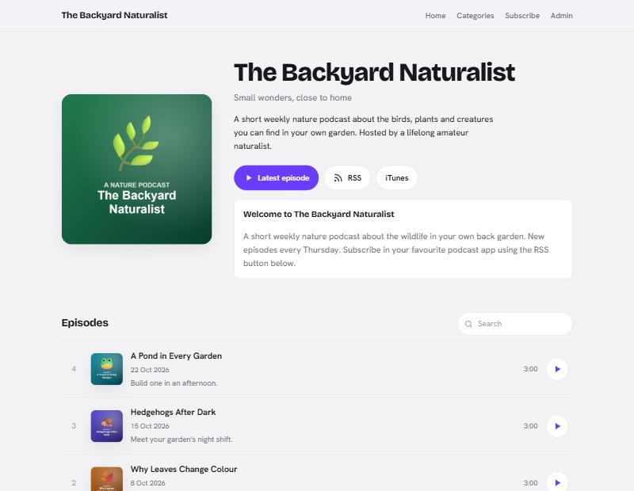
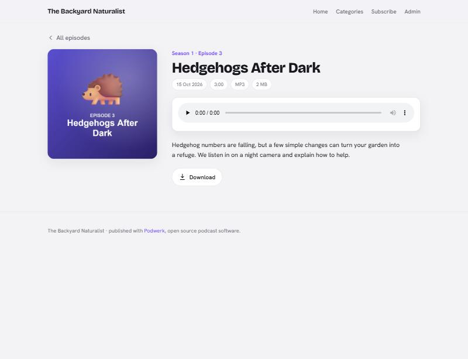
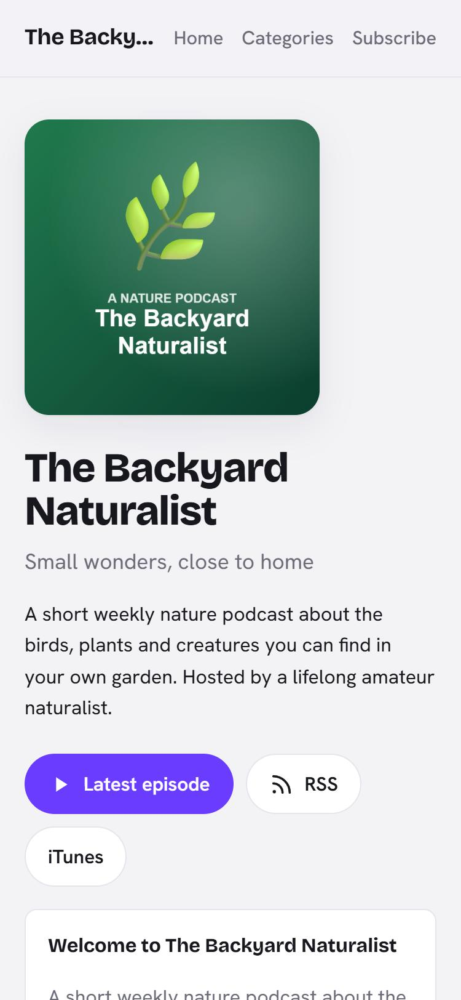

# Podwerk

Podwerk is an open source content management system for publishing a
podcast, written in PHP. It needs no database: episodes, settings and
categories are stored as files. You upload episodes, Podwerk builds the
website and the RSS feed for Apple Podcasts, Spotify, Podcast Index and
every other podcast app.

Podwerk is the maintained continuation of
[Podcast Generator](https://github.com/PodcastGenerator/PodcastGenerator),
which its authors archived in April 2026. It is a **drop-in upgrade for
Podcast Generator 3.2.x**: your configuration, episodes, logins and themes
keep working.



## Why Podwerk

* **A modern theme.** Podwerk ships a new default theme: the cover art
  leads, episodes read as a playlist, and it has a built-in dark mode. The
  classic theme is still included for sites that use it.
* **Security fixes** for Podcast Generator 3.2.9, including the published
  CVE-2023-53899, CVE-2023-53919 and CVE-2023-53920, and several issues
  found while taking over the code (see the [changelog](CHANGELOG.md)).
* **Current PHP**: tested on PHP 8.5, no deprecation warnings.
* **No known vulnerable dependencies**: `composer audit` is clean.
* **Maintained**: security and PHP compatibility updates for the 3.2
  series.

| Episode page | Dark mode | Mobile |
| --- | --- | --- |
|  |  |  |

<sub>Screenshots use a sample podcast ("The Backyard Naturalist") with placeholder content.</sub>

## Requirements

* PHP 7.0 or newer (tested on PHP 8.5) with the `gettext` and `simplexml`
  extensions; `curl` for Podcast Index and WebSub, `dom` for cleaning HTML
  in the freebox and episode descriptions
* Apache or nginx (see [INSTALL.nginx.md](INSTALL.nginx.md))

## Install

1. Download the latest release from the
   [releases page](https://github.com/boonstraworks/podwerk/releases).
2. Upload the contents of the `PodcastGenerator/` folder to your web space.
3. Open the address in your browser and follow the three setup steps.

More options, including a full Ubuntu server setup, are in
[INSTALL.md](INSTALL.md).

## Upgrade from Podcast Generator

1. Make a backup of your whole installation.
2. Upload the contents of the `PodcastGenerator/` folder of the Podwerk
   release over your installation and overwrite all files.

That is all for 3.2.9: settings, users, episodes, the feed URL and your
theme stay as they are, and the first request updates the version number
in `config.php`. Upgrading from Podcast Generator 3.1 or an early 3.2
release works the same way; the existing upgrade assistant converts the
configuration. Details, requirements and how it is tested:
[doc/update.md](doc/update.md).

## Testing

`tests/smoke.sh` checks a running installation from the outside: setup,
login, every admin page, CSRF and injection protection, an episode upload
and the generated feed.

`tests/upgrade.sh` installs the official Podcast Generator 3.2.9 package
with content, copies Podwerk over it and checks that settings, users,
theme, media and feed items stay the same.

```bash
tests/smoke.sh http://localhost/podwerk/PodcastGenerator admin secret-password
```

Run it against a throwaway installation: it changes settings and uploads a
test episode.

## Contribute

Bug reports, fixes and translations are welcome. See
[CONTRIBUTING.md](CONTRIBUTING.md). Please report security issues privately,
as described in [SECURITY.md](SECURITY.md).

## Credits and license

Podwerk is free software under the [GNU GPL 3.0](LICENSE).

It is based on Podcast Generator, created by Alberto Betella and developed by
Emil Engler, Chris Charabaruk and many contributors since 2006. Podwerk is
maintained by [BoonstraWorks](https://boonstraworks.nl) and is not
affiliated with or endorsed by the original authors.

This repository includes third-party software including
getID3 by James Heinrich,
Font Awesome by the Font Awesome Team,
and
Bootstrap from Twitter, Inc. and the Bootstrap Authors.
